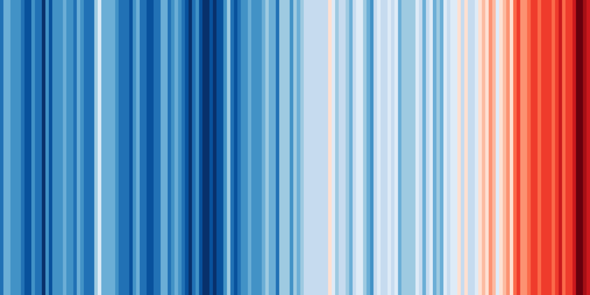

# Hi, I'm Adrián Ordóñez 👋

---

## 🚀 About Me

I'm a developer passionate about building software, learning new technologies, 
and turning ideas into practical solutions.

- 💻 Interested in software development and modern technologies
- 🌱 Always learning and improving my skills
- 🔭 Building personal projects and exploring new ideas
- ⚡ I enjoy solving problems through code

---

## 🛠️ Tech Stack

### Languages

### Tools & Frameworks

---

## 📌 Featured Projects

### 🔹 Project Name
Description of the project and what problem it solves.

[View Repository →](https://github.com/)

### 🔹 Project Name
Description of another project.

[View Repository →](https://github.com/)

---

## 📊 GitHub Stats

---

## 🌐 Connect With Me

---

## 🌐 Connect With Me

---

⭐ Thanks for visiting my profile!
